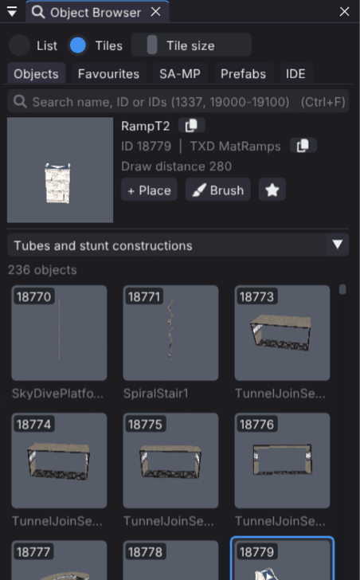
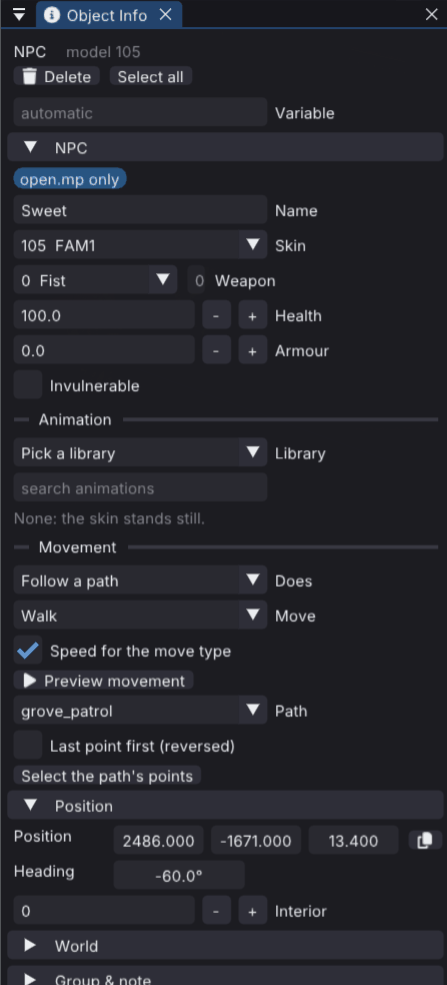

<p align="center"></p>

# Haumea Studio

**The all-in-one editor for SA-MP and open.mp.** Haumea Studio builds whole
server worlds on GTA San Andreas: objects and removed buildings, vehicles,
pickups, labels, sounds, checkpoints, open.mp NPCs with their routes and
recordings, textdraws and custom models, saved as Pawn your gamemode
includes. It checks the map against the server's limits and runs it on a
private open.mp server with one key.


New to Haumea? Read the **[user guide](docs/USER_GUIDE.md)**.

## What it can do

- Browse GTA and SA-MP models, categories, favorites, and textures. SA-MP models are filed in the categories of [Prineside's model list](https://dev.prineside.com/en/gtasa_samp_model_id/), and the search takes names, IDs, lists and ranges (`1337, 19000-19100`).
- Place, move, rotate, duplicate, and delete map objects with undo and redo.
- Edit selections with transform gizmos, snapping, ground alignment, and brush placement.
- Place vehicles with SA-MP's 256 colours, a number plate, a paintjob and one tuning part per slot from the parts that fit the model, all shown on the model in the viewport. Set static or dynamic creation and the respawn delay.
- Place SA-MP pickups, 3D text labels, actors, player classes (spawn points), gang zones, map icons and sound places from the browser's **SA-MP** tab. They are saved as native or streamer calls (`CreatePickup`, `Create3DTextLabel`, `CreateActor`, `AddPlayerClass(Ex)`, `GangZoneCreate`, `SetPlayerMapIcon` and their `CreateDynamic*` versions) and read back from existing scripts. Gang zones and native map icons are shown by the map's `_ShowForPlayer(playerid)`.
- Sound places play an audio stream (`PlayAudioStreamForPlayer`) or a game sound (`PlayerPlaySound`, picked from a searchable list) to players who come within their radius.
- Place open.mp NPCs with a name, skin, weapon, health and armour, and pick how they move: follow an NPC path you draw from path points (`NPC_MoveByPath`), walk the game's path nodes (`NPC_PlayNode`), or play a `.rec` recording (`NPC_StartPlayback`). **Preview movement** walks them in the viewport.
- Give actors and NPCs an animation (library and name, speed, loop, locks, freeze and time), saved as `ApplyActorAnimation` or `NPC_ApplyAnimation`. Skins play GTA's animations in the viewport, and stand in the idle pose otherwise.
- Play NPC recordings (`.rec`, on foot and driving) on a ped or vehicle with a timeline, and see the route drawn in the world.
- Edit the path nodes open.mp NPCs walk (`NODES*.DAT`) in the **Nodes** window and save them to a server's `scriptfiles/NPCs/nodes`. The game's own node files are never changed.
- Use SA-MP 0.3.DL and open.mp custom models from the server's `models/artconfig.txt` and `AddSimpleModel`/`AddCharModel` calls. They appear under **Custom models** in the browser and keep their negative IDs in the saved map.
- Edit several selected objects at once: a field changed in Object Info is set on every selected instance that has it, as one undo step.

<table>
  <tr>
    <td></td>
    <td></td>
    <td></td>
  </tr>
  <tr>
    <td align="center">Players and world elements on the SA-MP tab</td>
    <td align="center">SA-MP objects in Prineside's categories</td>
    <td align="center">An NPC that follows a path</td>
  </tr>
</table>

<table>
  <tr>
    <td></td>
    <td></td>
  </tr>
  <tr>
    <td align="center">The TextDraw designer</td>
    <td align="center">Test in game on a private open.mp server</td>
  </tr>
</table>
- Apply SA-MP texture, color, and text material overrides to objects. The viewport follows the 0.3.7 client: text is drawn with the real font files (including `{RRGGBB}` color embeds), and recolored materials lose their vertex lighting as they do in game. Material text fonts are looked up in the config folder's `fonts`, the Wine prefix's `windows/Fonts`, and the system font folders.
- Work on maps as Pawn files: New, Open, Save, Save As and recent maps, with autosave. Removed world objects become `RemoveBuildingForPlayer` calls.
- Give objects SA-MP settings that are saved in the map: a variable name, group, comment, draw and stream distance, virtual world, and attachment to another object (`AttachObjectToObject`). The **Map Objects** window (`Ctrl+3`) lists the map by group.
- Merge other Pawn files, including Texture Studio exports, and reuse prefabs.
- Generated Pawn compiles without warnings with both the open.mp and the SA-MP 0.3.7 includes. Calls only open.mp has are marked as such.
- Keep the game and your server apart: Haumea runs from its own folder, reads GTA San Andreas from the game folder without ever writing to it, and takes defaults from the workspace, the server you map for (see [Run](#run)).
- Rebind every keyboard shortcut in **Preferences → Shortcuts**.
- View generated Pawn live, inspect scene changes, and control the editor with the Namaka companion.
- Dock panels around the 3D view, or float them and let them snap to the screen edges and to each other.
- Use detachable panels on supported Windows builds.

## Maps

A map is a Pawn file. **File → Open Map** (`Ctrl+O`, or drop a `.pwn` on the window) replaces the scene with the file's objects, removed buildings, materials and settings; **Save** (`Ctrl+S`) writes it back, and **Save As** (`Ctrl+Shift+S`) picks a new file or switches between native `CreateObject` and streamer `CreateDynamicObject` code. Opening a file that uses the streamer keeps it in streamer format. The last map reopens on startup.

Texture Studio maps open the same way: pick or drop a `.db` from `scriptfiles/tstudio/SavedMaps`, or merge one with **File → Merge Pawn File**. Objects, textures, colours, material text, groups, notes, removed buildings and vehicles come across; Save then writes a new `.pwn` and never touches the `.db`.

Group and comment are stored after each object call as `// model @group("...") @note("...")`, so keep those comments when editing the file by hand. While a map has unsaved changes, Haumea writes copies to `autosave` in the config folder; **File → Recover Autosave** opens them. The **Live Pawn Code** window shows the generated source as you edit.

## Install

Download Haumea from the [releases page](https://github.com/itsneufox/Haumea/releases).
You also need GTA San Andreas (Haumea reads its models and textures) and, to
test maps, a SA-MP or open.mp server folder.

**Windows**: put `haumea.exe` and `glfw3.dll` from the release in one folder and
run `haumea.exe`.

**Linux** (x86_64, glibc 2.38 or newer: Ubuntu 24.04, Debian 13, Fedora 39 or
later): the release file `haumea` is the whole editor. Install GLFW and a file
dialog tool, make the file executable and start it:

```sh
sudo apt install libglfw3 zenity        # Fedora: sudo dnf install glfw zenity
                                        # Arch:   sudo pacman -S glfw zenity
chmod +x haumea
./haumea
```

`kdialog` works instead of `zenity`. Without either, Open, Save As and the
Browse buttons can't show a dialog; type paths instead. Your graphics driver
must support OpenGL 3.3 (Mesa does).

**Test in game** on Linux runs open.mp's Linux server and compiler, which are
32-bit programs. On a 64-bit Debian or Ubuntu, install the 32-bit C library
once:

```sh
sudo dpkg --add-architecture i386 && sudo apt update
sudo apt install libc6:i386 libatomic1:i386
```

The first start asks for your game folder and workspace (see [Run](#run)).

## Namaka

Namaka is bundled as a Python companion. Its CLI and MCP adapter connect to Haumea over a private local socket; the editor does not host MCP internally. See [the bundle setup guide](tools/release/AGENT_README.md) to install the companion, launch the editor with `--agent-socket`, and configure Claude Code or another MCP host. Its `save` command exports Pawn source through Haumea's native or streamer exporter.

## Build

Haumea builds with Premake and librw. Set `LIBRW` to the librw source directory. Run the commands from the Haumea checkout. `patch_librw_haumea.py` also swaps librw's Dear ImGui for the docking build in `vendor/imgui-docking`; without it Haumea still builds, but panels float instead of docking.

### Linux x86_64

```sh
export LIBRW=/path/to/librw

(cd "$LIBRW" && git apply "$OLDPWD/patches/librw-haumea.patch")
python3 tools/release/patch_librw_haumea.py "$LIBRW"
(cd "$LIBRW" && premake5 gmake2)
make -C "$LIBRW/build" config=release_linux-amd64-gl3 librw

premake5 gmake2 --channel=master
make -C build -j2 config=release_linux-amd64-gl3 haumea
```

The executable is `bin/linux-amd64-gl3/Release/haumea`. See [Run](#run).

### macOS

```sh
export LIBRW=/path/to/librw

(cd "$LIBRW" && git apply "$OLDPWD/patches/librw-haumea.patch")
python3 tools/release/patch_librw_haumea.py "$LIBRW"
(cd "$LIBRW" && premake5 gmake2 --gfxlib=glfw)
make -C "$LIBRW/build" config=release_macos-arm64-gl3 librw  # Apple Silicon
# or: make -C "$LIBRW/build" config=release_macos-amd64-gl3 librw  # Intel

premake5 gmake2 --channel=master
make -C build config=release_macos-arm64-gl3 haumea  # Apple Silicon
# or: make -C build config=release_macos-amd64-gl3 haumea  # Intel
```

### Windows

The Windows workflow uses the GLFW/OpenGL 3 build. Install Visual Studio,
Premake 5, and the GLFW 3.3.4 Win64 binary package. Then build both librw and
Haumea from PowerShell:

```powershell
$Haumea = 'C:\path\to\haumea'
$Librw = 'C:\path\to\librw'
$Glfw = 'C:\path\to\glfw-3.3.4.bin.WIN64'
$env:LIBRW = $Librw

Push-Location $Librw
git apply "$Haumea\patches\librw-haumea.patch"
python "$Haumea\tools\release\patch_librw_haumea.py" $Librw
premake5 vs2019 "--glfwdir64=$Glfw"
msbuild build\librw.sln /p:Configuration=Release /p:Platform=win-amd64-gl3 /t:librw /m
Pop-Location

Push-Location $Haumea
premake5 vs2019 --channel=master "--glfwdir64=$Glfw"
msbuild build\librwgta.sln /p:Configuration=Release /p:Platform=win-amd64-gl3 '/t:librwgta;haumea' /m
Pop-Location
```

## Run

Haumea runs from its own folder, from any working directory. On the first
start it asks for two folders:

- **Game folder**: your GTA San Andreas installation, with `gta_sa.exe` (or
  `models/gta3.img` and `data/`) and SA-MP's `SAMP/` files. Haumea only reads
  it; nothing is ever written there.
- **Workspace**: the SA-MP or open.mp server you are mapping for (the folder
  with `gamemodes/`, `scriptfiles/` and `omp-server`, `samp03svr` or
  `samp-server.exe`). Map dialogs start in its `gamemodes/`, NPC recordings
  come from its `npcmodes/recordings` and the Nodes tool uses
  `scriptfiles/NPCs/nodes`. It is optional.

Haumea opens on a start screen with your recent workspaces (pinnable), the
maps you opened in the selected one, with thumbnails, and the game folder.
"Open the last workspace automatically" skips it, and **File → Switch
Workspace** brings it back. Both folders can also be changed in **File →
Workspace** or **Preferences**. The window title shows the workspace. A new
game folder loads after a restart.

Settings and editor data (autosaves, recent maps, favourites, `imgui.ini`)
live in `~/.config/haumea` (`%APPDATA%\Haumea` on Windows, `~/Library/Application
Support/Haumea` on macOS). An older install's `<GTA>/haumea_data` is copied
there on the first start and left as it was.

The old layout still works: with Haumea inside the GTA folder, or started from
it, the game folder is found without asking.

Command line:

```sh
haumea [--game /path/to/GTA\ San\ Andreas] [--workspace /path/to/server] [--open map.pwn]
haumea --game /path/to/GTA --pawn-roundtrip in.pwn out.pwn   # open, save and quit
```

`--game` and `--workspace` apply to that run only. `HAUMEA_GAME_DIR` is also
read when nothing is saved yet.

## Tests

```sh
tools/haumea/tests/run_all.sh
```

runs everything on your machine: the unit tests in `tools/haumea/tests`, the
editor's Pawn round trip of the maps in `tests/pawn/maps` (their output must
match `tests/pawn/expected` and save again unchanged), and a compile of every
generated map as a gamemode, with no errors or warnings against the open.mp
includes and, for maps without open.mp-only calls, the SA-MP 0.3.7 ones. The
compiler (open.mp's `pawncc`) and the includes are downloaded once at pinned
versions. The game folder is `HAUMEA_GAME_DIR` or the one Haumea has saved;
without one, or with `--fixture`, the tests use a synthetic game folder that
`tests/fixture/make_game.py` writes: generated box models with the game's
model names, the data files the test maps need and path nodes made by the
Nodes tool's own code, and no game files at all. Tests that need a display or
the editor skip and say why. After an intended change to the exporter,
`run_all.sh --update-expected` refreshes `tests/pawn/expected`.

CI builds Linux, Windows and macOS for `main` and pull requests, and runs
`run_all.sh --fixture` on Linux under Xvfb: every test, the editor's round
trip of the test maps and the compile of its output.

## Lineage and license

Haumea is built on [librw](https://github.com/aap/librw) and [librwgta](https://github.com/aap/librwgta) by aap. The project depends on LZO, so consider the code in this repository dual-licensed as GPL.

Haumea Discord: https://discord.gg/yTF8DWQqpP

open.mp Discord: https://discord.gg/samp
